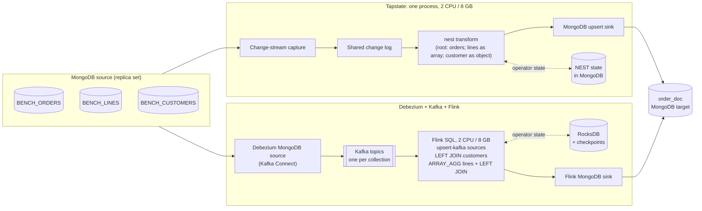
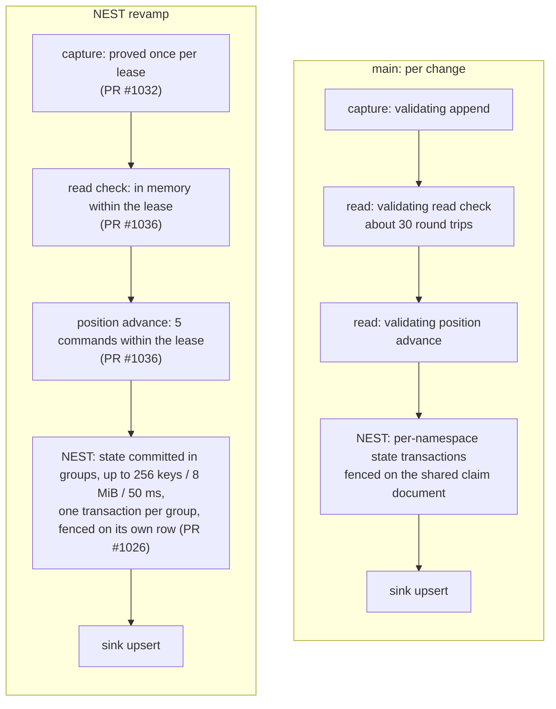
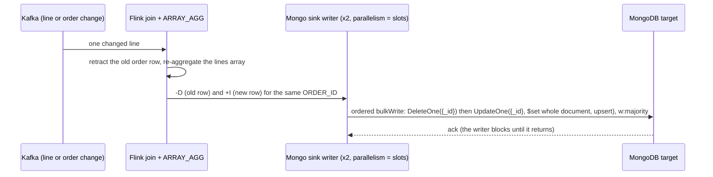
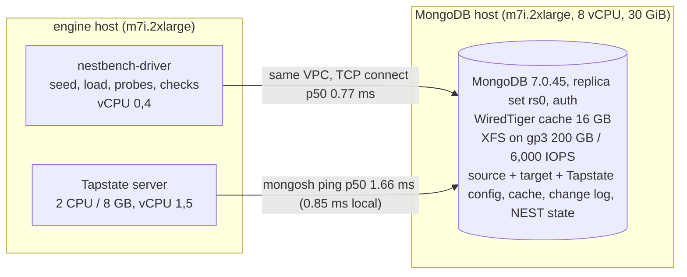
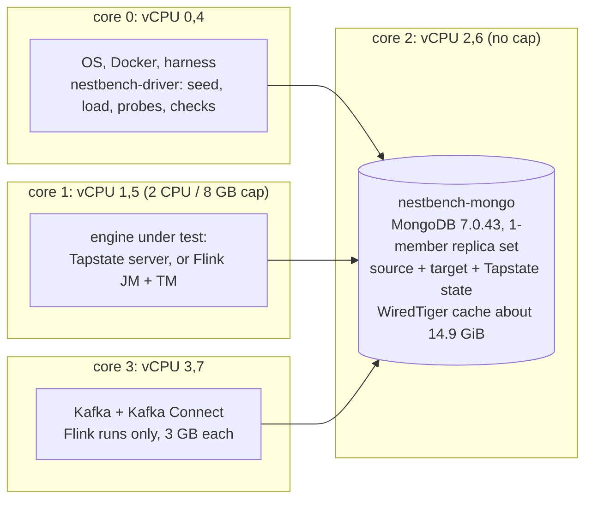

# Tapstate NEST vs a Debezium + Kafka + Flink stack

This benchmark builds one nested MongoDB document per order, with its order lines as an array and its customer as an
object. It then keeps that document in sync with the source while changes stream in. Two systems do the same job on
the same hardware:

- **Tapstate**, with its `nest` transform. We compare today's `main` with the **NEST revamp**, a stack of four open
  pull requests.
- **Debezium + Kafka + Flink SQL**, the usual open-source CDC stack. Flink runs joins and `ARRAY_AGG`, and writes
  through the Flink MongoDB sink.

Both systems read the same MongoDB source and write to the same MongoDB. Both get the same 2 CPU / 8 GB budget, the
same fixtures, the same load driver and the same content check.

Measured 2026-11-08 to 2026-11-10. Every number below comes from a file under [`results/`](results/).

## Summary

**34k fixture** (1,000 customers, 10,000 orders, 23,000 lines):

| | Tapstate `main` | Tapstate NEST revamp | Debezium + Kafka + Flink |
| --- | --- | --- | --- |
| Initial snapshot to a complete target | 325 to 359 s | **46 s** (40 to 41 s in earlier direct-store runs) | 44 to 70 s |
| Highest change rate held (events/s) | 25 (fails at 50) | **300** (fails at 600) | **300** (fails at 600) |
| End-to-end lag while holding 300/s | n/a, falls behind | **1.4 s** (0.4 to 1.4 s from 10 to 300/s) | 4.7 s (1.6 to 4.7 s from 10 to 300/s) |
| Changes applied per second at 600/s offered | far below, not drained in 900 s | about 460 | about 290 to 300 (320 to 460 across tuning runs) |
| CPU p50 during 300/s, engine / MongoDB | 136 % / 157 % (already behind) | 70 % / 106 % | Flink 11 %, Kafka + Connect 8 % / MongoDB 57 % |
| Content check after the change load | stale for about 300 s (backlog) | clean at the first check | clean at the first check |

**Tier B fixture** (100,000 customers, 1,000,000 orders, 2,300,000 lines, so 3.4M source rows):

| | NEST revamp, direct store on | NEST revamp, direct store off | Debezium + Kafka + Flink |
| --- | --- | --- | --- |
| Initial snapshot to a complete target | **34 min** (2,024 s) | 3.1 h (11,222 s) | 84 min (5,012 s) |
| Highest change rate held (events/s) | **300** | below 150 | **300** |
| End-to-end lag while holding 300/s | **0.6 s** (max 3.0 s) | n/a | 5.5 s (max 6.3 s) |
| Changes applied per second at 600/s offered | **about 520** | n/a | about 330 to 360 |
| What limits it at 600/s | MongoDB CPU (170 % of 200 %) | | Flink's MongoDB sink (see [Why Flink stops near 350/s](#why-flink-stops-near-350-changes-per-second)) |
| Content check, 10,000 sampled orders | 0 bad after snapshot and after the change load | 0 bad after both | 0 bad after snapshot; see the note below for after the change load |

**34k fixture, MongoDB moved to its own host** (Tapstate NEST revamp only; Flink not rerun, see
[MongoDB on its own host](#variant-mongodb-on-its-own-host)):

| | MongoDB on the engine host (one physical core) | MongoDB on its own 8-vCPU host |
| --- | --- | --- |
| Initial snapshot to a complete target | 46 s | **42 s** (same document hash) |
| Highest change rate held (events/s) | 300 (fails at 600) | **600** (fails at 1000) |
| End-to-end lag at 600/s | not held, 28 s and growing | **1.4 s**, flat |
| Changes applied per second at 1000/s offered | not run | about 720 |
| CPU p50 at the highest step, engine / MongoDB | 82 % of 200 % / 140 % of 200 % (at 600/s) | 65 % of 200 % / 142 % of 800 % (at 1000/s) |
| Content check after the change load | clean at the first check | clean at the first check |

**In short:** the revamp makes Tapstate's NEST snapshot about 7x faster than `main` on the small fixture. It also raises
the change rate Tapstate keeps up with from 25/s to 300/s. Against the Kafka + Flink stack, the revamp now matches it on
the small fixture. On the 1M-order fixture it builds the documents 2.5x faster than Flink, keeps up with the same 300/s
at about one tenth of the lag, and applies roughly 50 % more changes per second once both fall behind. It does that
with one process and no Kafka tier. Given a MongoDB of its own, the same revamp build holds 600 changes/s on the small
fixture. Flink has not been run against that MongoDB, so that result has no Flink counterpart yet.

Read the [caveats](#caveats) before you quote these numbers. The revamp is unmerged, the Tier B runs were on two
machines, the external-MongoDB run has no Flink counterpart, and a few cells are not like-for-like.

## What is compared

### The workload

Three source collections in MongoDB: `BENCH_ORDERS`, `BENCH_LINES` and `BENCH_CUSTOMERS`. The target is one
`order_doc` collection:

```json
{ "ORDER_ID": 42, "CUSTOMER_ID": 17, "STATUS": "...", "ORDER_TS": 1730000000000,
  "customer": { "CUSTOMER_ID": 17, "NAME": "...", "TIER": "..." },
  "lines": [ { "LINE_NO": 1, "SKU": "SKU-007", "QTY": 1, "PRICE": 1.25 }, ... ] }
```

The Tier B fixture includes orders with no lines (every 10th) and orders whose customer does not exist (every 25th).
Both systems must keep those orders with an empty or null `lines` or `customer`.

The change load is 80 % line quantity updates and 20 % order status updates, at fixed rates in steps. A step **holds**
when three things are true: the driver achieved at least 95 % of the target rate, the end-to-end lag at the end of the
step is under 10 s, and the lag grows by less than 0.05 s per second. The lag is measured by probe writes on both an
order and a line, and is the time until each probe is visible in the target document.

### The pipelines



| | Tapstate | Debezium + Kafka + Flink |
| --- | --- | --- |
| Moving parts | 1 container | 3 containers (Kafka in KRaft mode, Kafka Connect with Debezium, a Flink session cluster) |
| Pipeline definition | one `nest` step ([`results/tierb/revamp-direct-store-on/nest-pipeline.json`](results/tierb/revamp-direct-store-on/nest-pipeline.json)) | Debezium connector config, plus a Flink SQL job with two joins and an aggregate ([`flink/sql/`](flink/sql/)) |
| Where the change log lives | Tapstate's shared change log, in MongoDB | Kafka topics |
| Where the join state lives | MongoDB, the same `mongod` as source and target in this rig | RocksDB on local disk, checkpointed every 30 s |
| Write to the target per source change | an upsert of the affected order document | a delete plus a full-document upsert, about 1.8 writes per change |
| Resource cap | 2 CPU / 8 GB on the engine | 2 CPU / 8 GB on Flink (JobManager and TaskManager in one container). Kafka and Connect get another physical core and 3 GB each |

The Flink stack gets more hardware than Tapstate: Kafka and Kafka Connect run on their own physical core, on top of
Flink's 2 CPU / 8 GB. They stayed under 12 % CPU throughout, so the extra core does not change any result here. It is
still part of the cost of that architecture.

### What the NEST revamp changes

On `main`, a NEST pipeline paid for strong consistency on every single change. Each change made several fully validating
store transactions. Each transaction re-checked the cache's structure, the pipeline's claim and membership, and the
event's model, at 20 to 36 ms per round trip. Those transactions ran one after another on the reading thread, so the
pipeline could not go faster than about 50 changes per second, however many CPUs it had.

The revamp keeps the same guarantees but proves them once per lease or per group, not once per change:



| Pull request | What it does | Measured effect |
| --- | --- | --- |
| [#1020](https://github.com/tapstate/tapstate/pull/1020) | Validate NEST state once per lease instead of in every transaction | Snapshot state queries per row went from 39.9 to about 5.7. The 34k snapshot went from about 349 s to 134 s |
| [#1026](https://github.com/tapstate/tapstate/pull/1026) | "Direct store": a NEST vertex commits its state in groups, one transaction per group, fenced on a row of its own (behind `-Dtapstate.nest.store=direct`) | The 34k snapshot went from 134 s to 40 s. The Tier B snapshot went from 3.1 h to 34 min |
| [#1032](https://github.com/tapstate/tapstate/pull/1032) | Capture stores prove the shared change log once per lease | Throughput-neutral by itself, but required by #1036 |
| [#1036](https://github.com/tapstate/tapstate/pull/1036) | The consumer's read check and position writes are proved once per lease | The change-rate ceiling went from 50/s to 300/s. Read-check transactions went from 1.5 to 0.04 per change |

### Why Flink stops near 350 changes per second

On both fixtures, Flink's limit is its MongoDB sink. It is not CPU: at 600/s, Flink used about 11 % and `mongod` about
57 % of their CPU. The two sink writer subtasks were 98 to 100 % busy, and every upstream operator was 0 to 2 % busy
and backpressured.



- **Write amplification.** Each source change reaches the sink as about 1.8 records: a delete of the old order row
  plus an upsert of the whole new document, lines array included. The sink's ceiling was about 600 to 625 records/s at
  every rate from 300/s up, which is about 330 to 360 source changes/s.
- **Fixed parallelism.** The default sink parallelism equals the slot count, which is 2 within the 2-CPU cap. A sink
  parallelism of 4 does not fit in 2 slots, and the job loops in `RESTARTING`.
- **Settings that did not help.** On the 34k fixture we tried, one at a time, `sink.buffer-flush.max-rows=5000` and
  `sink.buffer-flush.interval=200ms`. Neither moved the ceiling. Mini-batch (`table.exec.mini-batch.*`, 1 s / 1000 rows)
  did help: it raised the ceiling from under 150/s to 300/s, so it is on in every published Flink run.

The writes probably cost so many round trips because the ordered bulk alternates deletes and upserts, which splits it
into many small commands. That is an inference from the driver's documented behaviour; we did not confirm it with a
profiler.

Tapstate's revamp sends one upsert per affected order document. At 600/s its limit is MongoDB CPU, at about 170 % of
the 200 % available. In this rig that one `mongod` also holds the source, the target and Tapstate's own state. The next section
moves it to a host of its own.

## Variant: MongoDB on its own host

On the main rig, `mongod` gets one physical core (2 vCPUs) and holds everything: the source, the target, the load
driver's writes and Tapstate's configuration, change log and NEST state. At 600/s that core was Tapstate's limit. In
this variant we moved all of it to a separate MongoDB host and kept everything else as it was. That means the same
engine host, the same 2 CPU / 8 GB engine container, the same Tier B revamp build (`04a5ad4a` + `a39adf64`, direct
store on), the same 34k fixture and the same harness.



| 34k fixture, revamp | MongoDB on the engine host ([run](results/34k/revamp-1/summary.json)) | MongoDB on its own host ([run](results/34k/revamp-external-mongo/summary.json)) |
| --- | --- | --- |
| Snapshot complete | 46.4 s | 42.3 s, same document hash |
| 300/s | held, 1.4 s | not run (the run starts at 600/s) |
| 600/s | not held: 28.0 s, +0.23 s/s, about 461/s applied | **held: 1.4 s, +0.005 s/s, max 1.5 s, drained in 3 s** |
| 1000/s | not run | not held: 60 s, +0.84 s/s, drained in 43 s; about 720/s applied by store writes |
| MongoDB CPU p50 (snapshot / 600 / 1000) | 43 % / 140 % / - of 200 % | 53 % / 119 % / 142 % of 800 % |
| Engine CPU p50 (snapshot / 600 / 1000) | 203 % / 82 % / - of 200 % | 202 % / 106 % / 65 % of 200 % |
| Content check after CDC | clean at the first check | clean at the first check (200 / 0 bad, 1.5 s) |

At 1000/s neither side is out of CPU. MongoDB is at 142 % of 800 %, and the engine's CPU falls from 106 % at 600/s to
65 % at 1000/s instead of rising. The engine is waiting, not computing. Every store call now pays a network round trip
of about 1.7 ms, against 0.85 ms on the shared host. On top of the per-event work, the configuration and sink stores
issue about 925 metadata commands per second (`listIndexes` about 670/s, `listCollections` about 255/s). Those
commands do not scale with the change rate. So the next limit is per-call latency on the store path, not MongoDB
capacity.

At 1000/s the lag probe's own key was starved behind the backlog, so the usual `rate x (1 - lag growth)` estimate reads
far too low (about 163/s). The 720/s figure is the measured write rate into the NEST state and change-log collections
(718 and 727 writes/s), which track applied events one for one at lower rates.

**This is not a like-for-like comparison with Flink.** Flink's 300/s ceiling and its sink analysis were measured with
MongoDB on the engine host. Flink's limit there was sink round trips, with `mongod` under one core, so a faster
MongoDB may move Flink too, or the longer round trip may slow it. Until Flink is run against the same external
MongoDB, compare this variant only with the Tapstate row above it.

## Rig

Both engines ran on AWS EC2 **m7i.2xlarge**: 8 vCPU (4 physical cores x 2 threads, Xeon Platinum 8488C), 30 GiB RAM,
200 GB gp3 at 6,000 IOPS. The OS was Ubuntu 26.04, with Docker 29.1.3 and Compose 2.40.3. Each tier is pinned to a
whole physical core, so no tier shares a core with another tier's hyperthread sibling:



Only one engine runs at a time.

| Component | Version |
| --- | --- |
| MongoDB | 7.0.43, mongosh 2.10.0 |
| Tapstate `main` | [`0a8fe300`](https://github.com/tapstate/tapstate/commit/0a8fe300360676cd4ebd4da8e902ea607aebee81) |
| Tapstate NEST revamp, 34k runs | [`04a5ad4a`](https://github.com/tapstate/tapstate/commit/04a5ad4acb55d207d58c10627038f873e2928c27): #1020 + #1026 + #1032 + #1036 (branch `ws/issue-1035-on-1026`) |
| Tapstate NEST revamp, Tier B runs | `04a5ad4a` merged with [`a39adf64`](https://github.com/tapstate/tapstate/commit/a39adf64140c47e77b14ecdd25be868485000b97) (#1026's head, which closes a state group at its bounds and fixes a heap exhaustion seen on the first 1M-order snapshot) |
| Tapstate JVM | JDK 21, `-XX:MaxRAMPercentage=65.0`, plus `-Dtapstate.nest.store=direct` for "direct store on" |
| Tapstate pipeline | `nest` step at parallelism 2, sink at parallelism 1 |
| Kafka | `apache/kafka:3.9.1` (KRaft, single node, 2 partitions per topic) |
| Debezium | `quay.io/debezium/connect:3.0.8.Final`, `capture.mode=change_streams_update_full` |
| Flink | `flink:1.20.2-scala_2.12-java17`, RocksDB incremental, 30 s checkpoints, 2 slots, parallelism 2 |
| Flink connectors | `flink-sql-connector-kafka-3.4.0-1.20`, `flink-sql-connector-mongodb-2.0.0-1.20` (sink defaults) |

Image digests are pinned in [`flink/docker-compose.yml`](flink/docker-compose.yml) and
[`flink/image/Dockerfile`](flink/image/Dockerfile).

## Reproduce it

Everything you need is in this folder and in public repositories. You need a Linux host with 8 vCPUs in 4 hyperthread
pairs and about 30 GiB RAM, plus Docker with Compose, git and Python 3.10 or later. On another host shape, map the core
layout above onto its real core pairs (`lscpu -e=CPU,CORE`) and edit the `cpuset` values in the scripts.

A full pass takes about 1.5 hours for the 34k fixture on all engines, and about 8 to 9 hours for Tier B on all engines.

```text
tapstate-nest-vs-kafka-flink-stack/
  harness/nest_bench.py       seed, scenarios, load driver, lag probes, content check, sampling (both engines)
  rig/setup-host.sh           network, MongoDB replica set, load-driver container
  rig/run-tapstate.sh         Tapstate protocol (34k or Tier B)
  rig/run-flink.sh            Flink protocol (34k or Tier B)
  rig/external-mongo-setup.sh MongoDB 7.0 on a separate host (variant)
  rig/run-tapstate-external.sh  Tapstate protocol against that host (variant, 34k)
  rig/remote-mongod-cpu.sh    samples the remote mongod's CPU during a run (variant)
  tapstate/build-image.sh     builds a Tapstate server image from a public revision (main, revamp, tierb)
  tapstate/install.sh         installs and starts one Tapstate server (storage setup, first admin)
  flink/                      Compose file, Flink image with pinned connectors, Flink SQL
  results/                    the JSON evidence behind every number in this README
```

### 1. Host and shared containers

```sh
git clone https://github.com/tapstate/tapstate-performance
cd tapstate-performance/tapstate-nest-vs-kafka-flink-stack
lscpu -e=CPU,CORE              # expect sibling pairs 0,4 / 1,5 / 2,6 / 3,7
MONGO_IMAGE=mongo:7.0 sh rig/setup-host.sh
```

### 2. Tapstate

Build the images. Each build runs Maven inside a container and takes 10 to 20 minutes:

```sh
sh tapstate/build-image.sh main
sh tapstate/build-image.sh revamp     # 34k runs
sh tapstate/build-image.sh tierb      # Tier B runs (revamp + the state-group bound fix)
```

Fetch the MongoDB connector. The server loads every jar in its connector seed directory at startup:

```sh
mkdir -p tapstate/connectors
curl -fL -o tapstate/connectors/mongodb-connector.jar \
  https://github.com/tapstate/tapstate/releases/download/connectors-preview/mongodb-connector.jar
sha256sum tapstate/connectors/mongodb-connector.jar
# at the time of the benchmark: 7fbdbf1ef2965053c9c5e6d28c0c21c3aa2818938ab758b965cc278d61e0c7b4
```

Install one server at a time. Each install gets its own storage databases, so a fresh install is a fresh state. Stop
the previous engine with `docker stop -t 60 <name>` first.

```sh
# main, 34k
sh tapstate/install.sh ts-main nestbench/tapstate:main 38182 _main ./creds-main.json
sh rig/run-tapstate.sh 942 main-34k-1 38182 ./creds-main.json tapstate_cache_main
docker stop -t 60 ts-main

# NEST revamp, 34k (direct store on)
sh tapstate/install.sh ts-revamp nestbench/tapstate:revamp 38183 _revamp ./creds-revamp.json -Dtapstate.nest.store=direct
sh rig/run-tapstate.sh 942 revamp-34k-1 38183 ./creds-revamp.json tapstate_cache_revamp
docker stop -t 60 ts-revamp

# NEST revamp, Tier B, direct store on and off (seeds 3.4M rows on first use)
sh tapstate/install.sh ts-tierb-on nestbench/tapstate:tierb 38184 _tierb_on ./creds-tierb-on.json -Dtapstate.nest.store=direct
sh rig/run-tapstate.sh tierb revamp-tierb-on 38184 ./creds-tierb-on.json tapstate_cache_tierb_on
docker stop -t 60 ts-tierb-on
SRC=$(python3 -c "import json;print(json.load(open('$HOME/nestbench/runs/revamp-tierb-on/summary.json'))['source'])")
sh tapstate/install.sh ts-tierb-off nestbench/tapstate:tierb 38185 _tierb_off ./creds-tierb-off.json
sh rig/run-tapstate.sh tierb revamp-tierb-off 38185 ./creds-tierb-off.json tapstate_cache_tierb_off "$SRC"
docker stop -t 60 ts-tierb-off
```

The `install.sh` script follows the documented on-prem procedure. It initializes an installation directory, starts the
server, and tests and commits three-layer MongoDB storage on the management channel. Then it restarts the server,
authorizes it, and creates the first administrator with a random password. The password goes to the credentials file
with mode 600. Nothing secret is printed.

### 3. Debezium + Kafka + Flink

```sh
cd flink && docker compose build flink && docker compose up -d && cd ..
curl -s localhost:8083/connector-plugins | grep -i mongodb    # Debezium MongoDB source present
curl -s localhost:8081/overview                               # 1 TaskManager, 2 slots

sh rig/run-flink.sh 942 flink-34k-1
sh rig/run-flink.sh tierb flink-tierb-1
cd flink && docker compose stop && cd ..
```

For each scenario, the harness creates a fresh Debezium connector, which snapshots the source into fresh topics, and
submits the Flink SQL job through the SQL client in the Flink container. The snapshot clock starts when the connector is
created, so Flink's numbers include SQL client start-up and job submission (10 to 20 s), just as Tapstate's include its
pipeline start request.

### 4. Optional: MongoDB on its own host

You need a second host for MongoDB, in the same VPC and availability zone as the engine host. The benchmark used an
m7i.2xlarge with a blank 200 GB gp3 data volume at 6,000 IOPS, running Ubuntu 26.04. In its security group, allow
inbound TCP 27017 from the engine host, and ICMP if you want a ping round trip. The engine host keeps
`nestbench-driver` from step 1. Its local `nestbench-mongo` is not used by this variant.

```sh
# on the engine host; EXT_SSH needs sudo on the MongoDB host
export EXT_SSH=ubuntu@<mongo-host-private-ip> EXT_IP=<mongo-host-private-ip> SSH_KEY=~/.ssh/<key>
sh rig/external-mongo-setup.sh          # formats the blank data disk, installs and configures MongoDB 7.0
                                        # passwords go to ./extmongo-creds.json (mode 600)

# check the round trip from the driver container (expect well under 2 ms)
EP=$(python3 -c "import json;print(json.load(open('extmongo-creds.json'))['engine']['password'])")
docker exec nestbench-driver mongosh --quiet "mongodb://nbengine:$EP@$EXT_IP:27017/?replicaSet=rs0&authSource=admin" \
  --eval 'const s=[];for(let i=0;i<100;i++){const t=Date.now();db.runCommand({ping:1});s.push(Date.now()-t)};s.sort((a,b)=>a-b);print("p50",s[50],"ms p99",s[99],"ms")'

# install a fresh Tapstate server whose storage lives on the external host, then run
MONGO_BASE="mongodb://nbengine:$EP@$EXT_IP:27017" MONGO_RS=rs0 MONGO_OPTS="&authSource=admin" \
  sh tapstate/install.sh ts-ext nestbench/tapstate:tierb 38186 _ext ./creds-ext.json -Dtapstate.nest.store=direct
sh rig/run-tapstate-external.sh revamp-34k-extmongo 38186 ./creds-ext.json tapstate_cache_ext
docker stop -t 60 ts-ext
```

`run-tapstate-external.sh` points the harness's driver and the engine's source and target connections at the
external host. It samples the remote `mongod`'s CPU into `remote-mongod-cpu.txt` when `EXT_SSH` is set. It redacts the
engine password from the run's log and `meta.json`. The protocol is the 34k snapshot, then CDC at 600/s for 120 s,
then 1000/s only if 600 held, then 1500/s only if 1000 held. It stops at the first step that does not hold.

### 5. Read the results

Each run writes `summary.json`, plus a file per phase (`snapshot.json`, `cdc.json`), a 5-second `docker-stats.jsonl`
and `cpu-percentiles.txt`. To compare with this README:

```sh
python3 - ~/nestbench/runs/*/summary.json <<'PY'
import json, sys
for f in sys.argv[1:]:
    s = json.load(open(f)); n = s.get('snapshot') or {}; c = s.get('cdc') or {}
    print(s['label'], 'snapshot %.0fs' % n.get('secondsToComplete', float('nan')),
          'ceiling', c.get('sustainedCeiling'),
          ' '.join('%d:%s/%.1fs' % (x['rate'], 'held' if x['held'] else 'no', x['endLagSeconds'] or -1)
                   for x in c.get('steps', [])))
PY
```

The fields are:

- `secondsToComplete` is when every order document is present and every one carries its lines and customer.
- `secondsToVerified` adds a sampled content check. For 1 % of orders, it compares the document field by field against
  the source, with lines compared as a set.
- `documentHash` is a hash of the whole target, normalized so that the same source state hashes the same on either
  engine.
- `appliedEventsPerSecond` is not recorded. The README's "applied at 600/s" figures are `rate x (1 - lag growth)`. They
  are a single-probe estimate and slightly low, because the probe queues behind the backlog. For Flink, the README also
  gives the job's own source-read rate from its REST metrics.

## Results in detail

### 34k fixture

| Run | Snapshot complete | 10/s | 25/s | 50/s | 150/s | 300/s | 600/s |
| --- | --- | --- | --- | --- | --- | --- | --- |
| [main-1](results/34k/main-1/summary.json) | 358.5 s | 1.2 s | 1.7 s | no (38.8 s) | no | no | no |
| [main-2](results/34k/main-2/summary.json) | 325.4 s | 1.1 s | 1.6 s | no (33.7 s) | no | no | no |
| [revamp, direct store off](results/34k/revamp-direct-store-off/summary.json) | 134.2 s | 0.2 s | 0.9 s | 1.1 s | no (81.7 s) | no | no |
| [revamp](results/34k/revamp-1/summary.json) | **46.4 s** | 0.4 s | 0.6 s | 1.1 s | 1.1 s | **1.4 s** | no (28.0 s, about 461/s applied) |
| [flink-1](results/34k/flink-1/summary.json) | 43.7 s | 1.9 s | 2.0 s | 2.1 s | 2.6 s | 4.7 s | no (64.7 s, about 291/s applied) |
| [flink-2](results/34k/flink-2/summary.json) | 70.2 s | 2.0 s | 2.0 s | 2.2 s | 1.6 s | 4.7 s | no (60.7 s, about 303/s applied) |
| [revamp, MongoDB on its own host](results/34k/revamp-external-mongo/summary.json) | 42.3 s | - | - | - | - | - | **1.4 s**; 1000/s no (60 s, about 720/s applied) |

Cells show the end-of-step lag of each step that held, or "no" with the end lag for a step that did not. Steps are
120 s each. Plain copy of the same 34,000 rows, as a reference: about 1,400 rows/s on Tapstate `main` and about
2,300 rows/s on Flink. Earlier direct-store-on runs on the same host (#1026 alone, or with the leases on earlier commits)
completed the snapshot in 40 to 41 s.

### Tier B fixture

| Run | All roots present | Snapshot complete | Snapshot rows/s | CDC steps (600 s each) | After the change load |
| --- | --- | --- | --- | --- | --- |
| [revamp, direct store on](results/tierb/revamp-direct-store-on/summary.json) | 2,022 s | **2,024 s** | 1,680 | 150 held (0.8 s), 300 held (0.6 s), 600 no (69 s, about 516/s applied), 1000 no (about 607/s applied) | 0/10,000 bad, settled in 21 s |
| [revamp, direct store off](results/tierb/revamp-direct-store-off/summary.json) | 11,219 s | 11,222 s | 303 | 150 no (58 s), 300 no (556 s) | 0/10,000 bad, settled in 47 s |
| [flink, ceiling run](results/tierb/flink-ceiling/summary.json) | 1,915 s | 5,012 s | 678 | 300 held (5.5 s), 600 no (339 s), 1000 / 1500 / 2500 no | backlog: 6,855/10,000 still stale when the 300 s window closed (see below) |
| [flink, low-rate run](results/tierb/flink-low-rates/summary.json) | 1,942 s | 5,034 s | 675 | 10 / 25 / 50 / 150 held (2.2 to 3.0 s) | 0/10,000 bad at the first check |

CPU p50 per phase (100 % is one vCPU):

| | snapshot: engine / MongoDB | 300/s: engine / MongoDB | 600/s: engine / MongoDB |
| --- | --- | --- | --- |
| revamp, direct store on | 201 % / 62 % | 63 % / 139 % | 58 % / 169 % |
| revamp, direct store off | 50 % / 60 % | 57 % / 93 % (behind) | not run |
| flink | Flink 15 %, Kafka + Connect 2 % / 40 % | Flink 13 %, Kafka + Connect 7 % / 58 % | Flink 11 %, Kafka + Connect 7 % / 57 % |

On Tier B, Flink's snapshot is bound by its sink, just as its change rate is. During the fill, Flink used 15 % CPU and
`mongod` 40 %. Flink inserts each order before its joins are complete and then rewrites it as its lines arrive. So all
1M order documents are present after 32 minutes, but they are only complete after 84.

## Caveats

- **The NEST revamp is unmerged.** It is four open pull requests, measured at the commits listed under [Rig](#rig).
  The direct store is behind a switch that is off by default. Tapstate `main` today behaves like the `main` column,
  not the revamp column.
- **The Tier B "direct store off" column is not `main`.** It is the revamp build with only the direct store switched
  off, so it still has the lease changes from #1020, #1032 and #1036. `main` itself has no Tier B NEST result. A
  `main` Tier B run was stopped after 25 minutes without having written its first order document, to free the rig.
  On the 34k fixture, `main` took about 2.6x longer than "direct store off".
- **Tier B ran on two machines.** The Tapstate Tier B runs were on one host and the Flink Tier B runs on a second
  host. Both were the same instance type, with the same core layout, images and harness. As a cross-check, the same
  Tapstate build (#1020) completed the 34k snapshot in 134 s on the first host and 133.8 s on the second. All 34k
  results come from the first host.
- **Flink after the overload steps.** In the Tier B ceiling run, the last step offered 2,500 changes/s and ended about
  30 minutes behind. The harness's 300-second settle window closed while the sink was still draining. Every stale
  sample failed on `lines` (quantity updates not yet applied), and the count was still falling. This is backlog, not
  wrong output: the low-rate Tier B run, where every step held, was clean at the first check. Tapstate's Tier B
  overload steps (600 and 1000/s) drained within the window.
- **The Flink target carried an extra index.** Before the content check, the harness creates an `ORDER_ID` index on
  Flink's target (Flink keys documents by `_id` only), so the check does not scan 1M documents per sample. On Tier B
  this index existed during the change load, so Flink maintained one more index than strictly needed.
- **One shared MongoDB.** On the main rig, the source, the target, the load driver's writes and, for Tapstate, the
  NEST state and the change log all live in one `mongod` on one physical core. That is the same for both engines. It
  is also Tapstate's limit at 600/s, and moving it to its own host raised Tapstate's ceiling to 600-1000/s.
- **The external-MongoDB run has no Flink counterpart.** Only Tapstate was run against the separate MongoDB host, once,
  with the 34k fixture. That host also differs from the main rig in more than its size: MongoDB 7.0.45 from the
  official packages instead of 7.0.43 in a container, authentication and a keyFile on, a 16 GB cache, and XFS on a
  dedicated volume. Compare it with the Tapstate rows only.
- **Discarded runs.** Several revamp runs on 2026-11-09 ran while a profiler had left `mongod`'s server-wide `slowms`
  at 0, so `mongod` logged every operation. Those runs are not used here. The 34k revamp numbers come from a clean
  rerun, and both Tier B revamp runs had profiling off and `slowms` at 100. The `main` and Flink runs were earlier and
  unaffected. `rig/setup-host.sh` sets `slowms` back to 100.
- **Single runs.** Most cells are one run. Two runs each exist for 34k `main` and 34k Flink, and they show how much
  Flink's snapshot varies (44 vs 70 s).
- **Harness changes since the runs.** The published harness merges two versions used on the two hosts:
  `--cdc-stop-after-failures` and `--cdc-extra-if-held` from one, and the join scenarios and Flink target index from
  the other. The 34k results predate a seed change that stores `PRICE` as a BSON double. The NEST and Flink pipelines
  read `PRICE` as a double either way.
- **Images.** The benchmark's Tapstate images were built from the same source revisions with a development build tool
  that also embeds the web console and seeds the connector into the image. `tapstate/build-image.sh` builds the public
  server-only image from `deploy/docker/Dockerfile` instead, with the connector mounted from the `connectors-preview`
  release. The engine code is the same. The packaging differs, and we have not re-run the full protocol on this exact
  packaging.

## License

The scripts, SQL and harness in this folder are released under the Apache License 2.0, like Tapstate.
